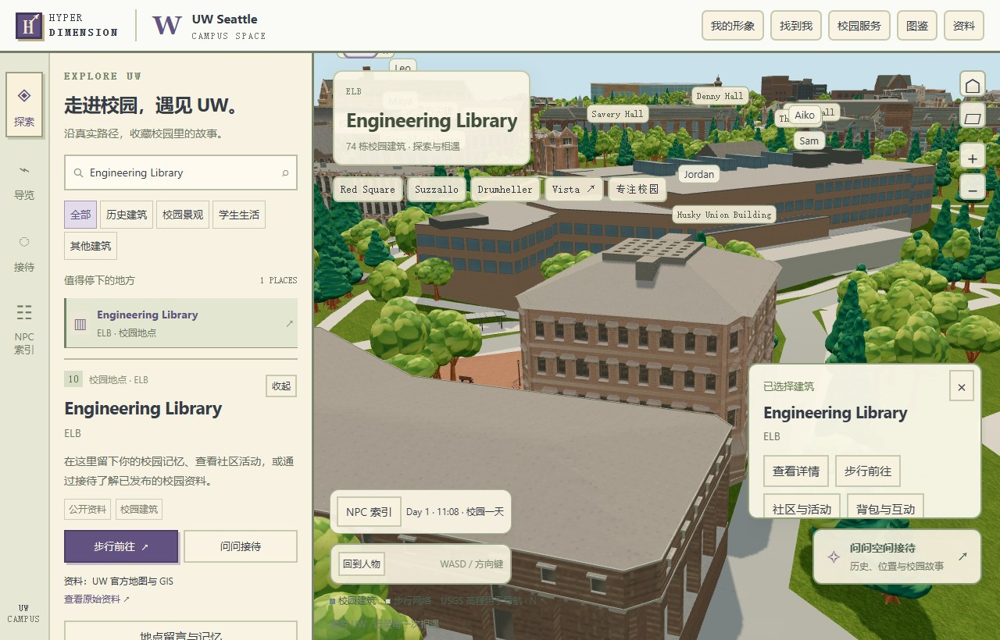
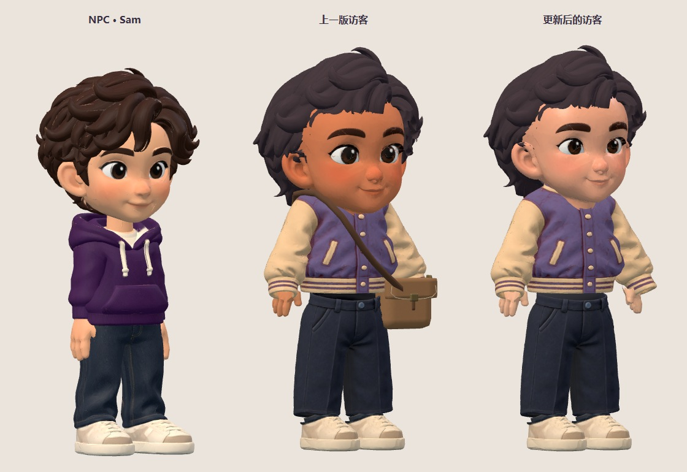

# Hyper Dimension UW

[简体中文](README.md) · [Source and asset scope](docs/REPOSITORY-SCOPE.md) · [Contributing](CONTRIBUTING.md)

An independent 3D campus experience set at UW Seattle, built on Hyper Dimension Base. The current source release is **v0.13.0-dev.124**.



Explore on foot or follow a landmark route, meet six fictional campus NPCs, and save a custom visitor avatar. The complete art set covers 72 buildings with near and far detail and two open spaces, Red Square and Drumheller Fountain. The signed-in school experience includes place communities, forum moderation, direct messages, inventory, campus reception and A2A.



## Run locally

Install Node.js 22.13+ and Python 3.11+. Download `Hyper-Dimension-UW-dev.124-art.zip` from [GitHub Releases](https://github.com/MkaliezZ/Hyper-Dimension-UW/releases/tag/v0.13.0-dev.124-art) and place it in the checkout root.

```sh
npm ci --prefix base --omit=dev --ignore-scripts
npm run verify:source
python scripts/restore-campus-art.py --art-pack Hyper-Dimension-UW-dev.124-art.zip
npm run verify:models
npm start
```

Open [the local campus](http://127.0.0.1:4190/). Use `START-UW.cmd` on Windows or `sh start-uw.sh` on Ubuntu. Set `PORT` and `UW_DATA_DIR` for an isolated instance. See the [deployment guide](docs/DEPLOY-UW.md) for the sign-in stack and [the A2A workbench](docs/A2A-TASK-WORKBENCH.md) for client examples.

## Verification

The complete dev.124 ZIP was extracted and started on Windows and Ubuntu. Browser checks covered rendering, avatar save and reload, walking, NPC discovery and reception. An isolated native WSL Ubuntu stack passed nine school-service scenarios, and live Hermes checks covered dialogue, memory after restart, session isolation, export and deletion. Docker Compose configuration was checked.

## Licensing

Project-owned code and artwork are covered by the [project notice](LICENSE). See [component and asset notices](LICENSES.md) and the [Base MIT license](base/LICENSE). Data and photographs retain their source attribution. The screenshots come from the dev.124 validation run.

See the [test notes](tests/README.md) for historical Canvas 2D, fixed-station NPC and terrain assertions.
