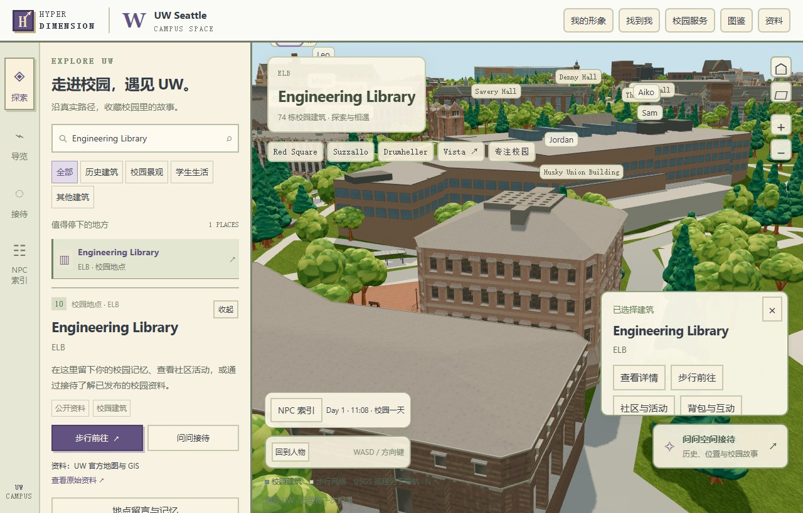
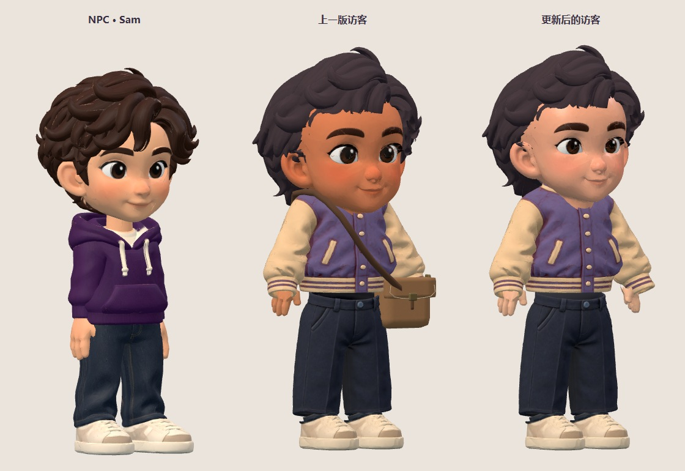

# Hyper Dimension UW

[English](README.en.md) · [源码与素材范围](docs/REPOSITORY-SCOPE.md) · [贡献指南](CONTRIBUTING.md)

以 UW Seattle 校园为原型的独立三维校园体验，基于 Hyper Dimension Base。当前源码版本为 **v0.13.0-dev.124**。



在校园里自由步行或按地标导览，和六位校园 NPC 互动，搭配并保存自己的校园形象。完整美术包含 72 栋建筑的近远景纹理模型，以及 Red Square 和 Drumheller Fountain 两处开放场地。正式登录后可访问地点社区、论坛、私信和背包互动，并使用学校接待与 A2A 服务。



## 本地启动

需要 Node.js 22.13+ 和 Python 3.11+。先从 [GitHub Releases](https://github.com/MkaliezZ/Hyper-Dimension-UW/releases/tag/v0.13.0-dev.124-art) 下载 `Hyper-Dimension-UW-dev.124-art.zip`，放到仓库根目录。素材包包含建筑模型、角色、植被、贴图和换装缩略图。

```sh
npm ci --prefix base --omit=dev --ignore-scripts
npm run verify:source
python scripts/restore-campus-art.py --art-pack Hyper-Dimension-UW-dev.124-art.zip
npm run verify:models
npm start
```

打开 [本地校园](http://127.0.0.1:4190/)。Windows 也可用 `START-UW.cmd`，Ubuntu 可用 `sh start-uw.sh`。新实例可设置 `PORT` 和 `UW_DATA_DIR`。正式学校服务、Ubuntu 配置、授权和模型密钥注入见 [部署手册](docs/DEPLOY-UW.md)，A2A 示例见 [A2A 工作台说明](docs/A2A-TASK-WORKBENCH.md)。

## 本版验证

完整交付包通过 Windows 和 Ubuntu 解压启动，浏览器覆盖近远景渲染、访客换装与刷新恢复、步行、NPC 索引和资料接待。WSL Ubuntu 原生服务完成登录、论坛审核、私信、贡献计分、检索等 9 项业务检查，Hermes 通过真实对话及会话隔离、恢复、导出与删除检查。Docker Compose 通过配置校验。

## 来源与许可

这是独立校园项目。建筑轮廓、地名和地形分别使用已署名的 Seattle、UW 与 USGS 资料。各部分的许可见 [项目声明](LICENSE)、[素材与依赖许可](LICENSES.md) 和 [Base MIT 许可](base/LICENSE)。照片沿用逐文件署名。两张截图来自 dev.124 的隔离联调渲染。

旧版 Canvas 2D、固定站位 NPC 与历史地形断言的适用版本见 [测试说明](tests/README.md)。
